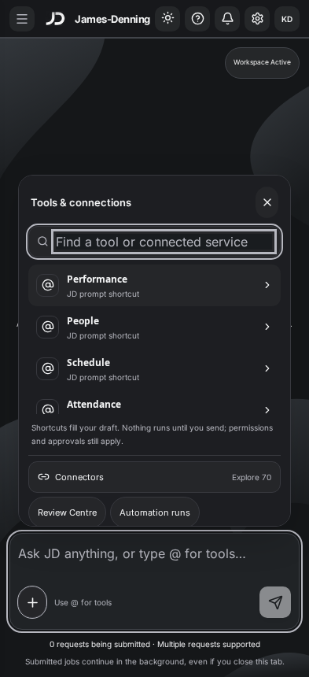
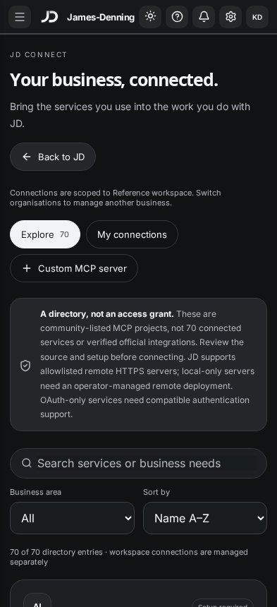

# JD composer tools and connector directory

**Status: implemented and locally tested; not deployed or production-accepted.**

Work is on `arena/0ffaaae0-james-denning`, based on `5f69d646ae7ded33348354948be41112f8937533`. At the local-verification checkpoint, this feature had not been committed, submitted as a PR, merged, or deployed. The user subsequently authorized creation and merge of a PR; GitHub's PR/check records track that follow-up. The directory date is the session's supplied local date, 2026-11-16.

## Delivered

- A **+ tools menu** inside the existing JD composer, using JD's shared light/dark theme tokens. Search, keyboard arrows, Enter selection, Escape and outside-click dismissal are supported.
- **@ shortcuts** at the text caret, with Enter/Tab selection and email-address exclusion. Existing text after the caret is preserved.
- Native entries are explicitly **JD prompt shortcuts**. External suggestions come from the current workspace's gateway inventory and only reference tools belonging to servers marked connected. Load failures hide external suggestions and offer Retry.
- Selection **only fills the draft**. It does not submit, register a server, change grants or execute a tool. A connected-tool prompt asks JD to rediscover/check authorization; it is not a pinned execution or guarantee that a particular tool will run.
- A **70-entry directory** with search, business-area filtering, alphabetical/category sorting, source/setup details, Explore/My connections, and explicit custom-server registration through the existing JD Connect gateway.
- Entry points in the composer, JD sidebar and Settings integrations. Back to JD preserves the draft. Workspace scope is named in the directory.
- Registration validates HTTPS/no embedded credentials, requires a confirmed response, and clears the typed token on cancellation, form toggling or success. Owner/admin/manager UI access follows the existing gateway roles; widening access is only enabled for owner/admin. Backend authorization remains authoritative.

### Business areas

| Area | Entries |
| --- | ---: |
| Sales & customer support | 7 |
| Finance & accounting | 5 |
| Communication | 10 |
| Projects & knowledge | 10 |
| Engineering & cloud | 10 |
| Data & analytics | 10 |
| Research & web | 9 |
| Logistics & location | 9 |
| **Total** | **70** |

## What the directory does not establish

These are **70 community-listed project references, not 70 connected services**. All catalogue endpoints are `null` and compatibility is `not_verified`. Entries are labelled “Setup required”; a repository URL is never used as an MCP endpoint.

Source discovery used `punkpeye/awesome-mcp-servers` (observed HEAD `5fb385c3c56a004eacad6a21cb446205c787926b`) and the guidance in `modelcontextprotocol/servers`. GitHub metadata was retrieved for all 70 final source repositories; all were nonarchived when checked. This establishes repository existence/nonarchival only—not publisher ownership, safety, transport/auth compatibility, current maintenance, source-subdirectory availability or successful execution. Two initially selected archived repositories were replaced before the final catalogue check. See `catalogue-sources.json` and `source-link-checks.json`.

The existing gateway supports allowlisted remote HTTPS servers with its existing authentication/encryption and permission controls. This change does **not** implement OAuth onboarding, stdio hosting, credential provisioning, local server execution, a new allowlist, or automatic installation. Local-only projects need operator-managed deployment; OAuth-only projects need compatible authentication support. Provider costs may apply.

No production credentials were supplied and no production connector registrations, grant changes, model calls or workflow dispatches were made for this feature. No source-server code was executed. The previous capability audit's backend/staging gaps remain open; in particular this UI change does not resolve the previously documented elevated-grant/write-approval policy concern. Menus are not security enforcement.

## Verification and evidence

| Check | Result | Evidence |
| --- | --- | --- |
| All non-layout Node suites, including the new unit suite | **1,234 passed; 0 failed/skipped** | `node-tests.log` |
| New catalogue/parser/role/inventory unit tests | **12 passed** (included above) | `unit-tests.log`, `browser-tests.log` |
| New real-component Chromium fixture | **36 theme states passed**, at widths 320/393/1280 in light/dark | `browser-tests.log`, `browser-results.json` |
| Contrast sampling in those states | **3,462 text samples; 0 detected findings** | `browser-results.json` |
| Existing chat/settings/agent/foundation/registry/reference/site/conversation/theme layout suites | **Passed** | `existing-layout-tests.log` |
| Web production build and asset verification | **Passed** | `build-verification.log` |
| Verification safety guards | **43 passed** | `verification-guards.log` |
| npm dependency audit, high-severity gate | **0 vulnerabilities reported** | `dependency-audit.log` |
| Whitespace/diff check | **Passed** | `git diff --check` at completion |

Browser flows cover native and connected-tool draft insertion, keyboard navigation, outside dismissal, email exclusion, disabled-server exclusion, failed inventory/retry, directory navigation/search/filter/sort, source setup, HTTPS validation, token clearing, synthetic explicit registration, no automatic calls/grants/submission, manager versus owner grant controls, and viewer restrictions. Fixture networking is intercepted; the registration response is explicitly synthetic. These are **not live MCP or tenant-isolation acceptance tests**. Contrast sampling is not a complete accessibility certification or a real mobile-device/virtual-keyboard test.

Testing found a stale external suggestion visible after an inventory failure. Remote suggestions are now cleared on close and suppressed during loading/errors or insufficient role; the final browser suite passes. An additional outside-dismissal test initially clicked a heading covered by the menu; the test now clicks an unobstructed outside position. Neither failure is represented as a passing initial run.

The build retains its existing configuration/large spreadsheet-chunk warnings. No dependency versions or backend/database policies were changed. The connector test command is now included in `test:chat-layout`, so the existing CI layout job will run it; **remote CI had not run at this local-verification checkpoint**. The existing-layout log predates that command addition; the new `npm run test:connectors` command was then run separately and passed.

### Screenshots

Screenshots use synthetic workspace/server data and real application components. Mobile light/dark captures are included for the plus menu, mention menu, error/retry state, directory, setup details and registration form.





## Reproduce

```sh
npm ci
npm run verify:web
npm run test:guards
npm audit --audit-level=high
node --experimental-strip-types --test $(find scripts -maxdepth 1 -name 'test-*.mjs' ! -name '*layout*' ! -name 'test-verification-guards.mjs' | sort)
# Requires Chromium; set CHROMIUM_EXECUTABLE_PATH if not in a standard location.
npm run test:chat-layout
# To regenerate the feature screenshots and browser-results.json:
JD_CONNECTOR_EVIDENCE_DIR=docs/evidence/2026-11-16-composer-connectors npm run test:connectors
git diff --check
```

In this sandbox Chromium was `/tmp/chromium`, with `LD_LIBRARY_PATH=/tmp/lib` and `FONTCONFIG_PATH=/tmp/fonts`; those temporary dependencies are not part of the repository or persisted evidence. CI can use its installed Chrome/Chromium.

## Release boundary

The user has authorized PR creation and merge, subject to passing checks. That does not authorize connecting services, changing grants or declaring production acceptance. After release, real acceptance should use an explicitly approved least-privilege server in the isolated staging environment, verify authentication/transport/discovery, exercise permitted and denied operations and approval boundaries, and record the tested release and deployment. Existing staging isolation/readiness gates must be resolved first. No production acceptance is claimed by this report.
