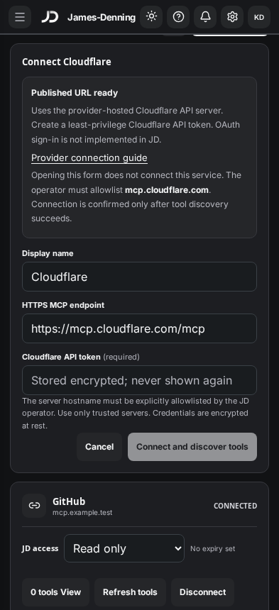

# Published MCP URLs and prefilled connections

**Status: supported portion implemented and locally tested; not committed, deployed or live-connected.**

Branch: `arena/ab7720d0-james-denning`, based on `4151925531ab84cf5493adbf8d0f7449258fbe45`. The folder uses the session-supplied date. The request was to remove manual URL entry for all 70 directory listings. This delivers documented hosted presets where found, **not a claim that all 70 services can now connect in one click**.

## User-visible changes

- Cloudflare's Connect button now opens the form with **`https://mcp.cloudflare.com/mcp`** already filled in and the required Cloudflare API-token label. The form scrolls into view without automatically opening the mobile keyboard.
- Other documented, Bearer-compatible hosted services have the same direct Connect → prefilled form flow. Selecting a service does not register it. The user supplies any required token and explicitly confirms **Connect and discover tools**.
- The directory distinguishes **Hosted URL**, **Sign-in needed**, **Auth setup needed**, and **Custom setup**. A Setup filter separates published hosted URLs from custom endpoints.
- Every published preset has a provider/project connection-guide link. When a preset uses a provider-hosted implementation rather than the original community project, the UI explains that distinction and retains both source links.
- Known unsupported OAuth/header schemes are visibly gated rather than sending an ordinary Bearer token and pretending sign-in is available. Trailing slashes/query options do not remove this gate.
- Required-token forms cannot submit without a token. Changing the endpoint clears the token so a credential is not inadvertently carried to a new destination. Cancel/toggle also retains existing token-clearing behavior.
- Registration failure remains an error; a saved URL is not reported as a connected server. Existing backend allowlisting, auth, encryption, permissions and approval controls remain unchanged.
- Corrected the introductory grant wording to owner/admin, consistent with the existing access-widening controls.

## Coverage and limits

| Directory status | Listings | Meaning |
| --- | ---: | --- |
| Hosted URL, required Bearer token | 9 | Cloudflare, GitHub, Supabase, Neon, Context7, Apify, Resend, Linear, Airtable |
| Hosted URL, optional Bearer token | 2 | Exa and Firecrawl document limited public access; authenticated features/limits may differ |
| Hosted URL, provider sign-in support needed | 8 | Notion, Asana, ClickUp, Slack, Pipedrive, Todoist, Jira and Confluence |
| Hosted URL, other auth support needed | 4 | Bankstatemently, Sentry, HasData Google Maps and IP2Location |
| No shared hosted URL verified for this listing | 47 | Custom/operator deployment or further provider review required; endpoint stays blank |
| **Total** | **70** | **23 listings have hosted URLs; 11 fit JD's current auth mechanism** |

Jira and Confluence share an Atlassian endpoint: 23 listings correspond to 22 distinct preset URLs. The UI warns against registering that shared endpoint twice.

The 47 blank URLs are deliberate: local stdio commands, repository URLs, tenant-specific placeholders, ordinary REST endpoints and third-party demonstration gateways are not substitutes for a verified shared hosted MCP URL. Reading a root README does not prove that no hosted option exists anywhere; these are the entries for which no suitable shared URL was verified in this review. Further provider investigation can increase coverage.

**Remaining work for universal click-to-connect:** provider OAuth/client registration and callback handling, other auth schemes/headers, and operator-managed endpoints for projects without shared hosting. These are not supplied by merely adding URLs. No OAuth implementation, arbitrary-header forwarding, automatic allowlist expansion, backend migration or production configuration change was included.

## Provenance

All 70 listed repositories' root READMEs were retrieved through GitHub, with hashes recorded in `catalogue-review.json`. Provider-hosted alternatives were checked against additional publisher repositories and official provider documentation. `endpoint-sources.json` contains each selected URL, auth classification, source link, excerpts and a `runtimeVerified: false` flag. It also identifies the supplemental Supabase PAT documentation. [INVENTORY.md](INVENTORY.md) lists the result for every entry.

Examples: the Cloudflare API server README documents both its hosted URL and API-token option; GitHub documents its hosted MCP URL; Linear documents a read-only URL and API-key authentication; Airtable explicitly documents the Bearer PAT header. Bankstatemently explicitly rejects ordinary Bearer credentials, and ClickUp documents OAuth-only authentication, so those forms are gated. Notion and other provider-hosted alternatives are not silently treated as identical to the original community server.

Documentation review is **not runtime verification**, a publisher security audit, or an availability guarantee. No endpoint was probed with a real credential, no real connector was registered, and no tools were called. Provider charges and token scopes still need review. Browser test registrations and failures are explicitly synthetic.

## Local verification

| Check | Result | Evidence |
| --- | --- | --- |
| Complete chat/settings/site/conversation/theme layout chain | Passed | `all-layout-tests.log` |
| Connector catalogue/helper tests | 15 passed | `connector-tests.log` |
| Deterministic composer focus regression | All four selection paths passed | `connector-tests.log` |
| Extended real-component browser suite | 54 theme states passed at 320/393/1280 widths, light/dark | `browser-results.json`, `connector-tests.log` |
| Text contrast sampling | 4,668 samples; zero detected findings | `browser-results.json` |
| All non-layout Node suites | 1,237 passed, zero failed/skipped | `node-tests.log` |
| Production web build and asset verification | Passed; existing configuration/large-chunk warnings retained | `build-verification.log` |
| Safety guards | 43 passed | `verification-guards.log` |
| npm audit | Zero vulnerabilities reported | `dependency-audit.log` |
| Diff whitespace check | Passed | `git diff --check` |

Browser tests verify all 23 preset URL values and auth gates, Cloudflare's direct Connect path, hosted/custom counts, required tokens, token clearing on destination changes, a rejected registration, no success claim after failure, Notion sign-in gating, unchanged manual PostgreSQL setup, viewer/manager/owner behavior and no automatic registration/grant/tool execution. The existing synthetic registration success path remains covered.

After the full layout chain, the registration button's inline opacity override was removed so the existing disabled-button styling can apply. The final connector suite and production web build were rerun successfully after that cosmetic change. `source-hashes.json` identifies the final tested feature files. These are local synthetic browser checks, not full accessibility certification or production acceptance.

## Screenshot

Real components with synthetic workspace/server data; the GitHub server visible below the form is a test fixture, not a production connection.



## Reproduce and release

```sh
npm ci
npm run verify:web
# Requires installed Chromium/Chrome (or CHROMIUM_EXECUTABLE_PATH).
npm run test:chat-layout
JD_CONNECTOR_EVIDENCE_DIR=docs/evidence/2026-11-16-mcp-endpoints npm run test:connectors
node --experimental-strip-types --test $(find scripts -maxdepth 1 -name 'test-*.mjs' ! -name '*layout*' ! -name 'test-verification-guards.mjs' | sort)
npm run test:guards
npm audit --audit-level=high
```

Temporary sandbox browser tooling was installed only under `.cache/browser` and `/tmp`, not in application dependencies. Browser commands used `CHROMIUM_EXECUTABLE_PATH=/tmp/chromium`, `LD_LIBRARY_PATH=/tmp/lib`, and `FONTCONFIG_PATH=/tmp/fonts`.

No PR or deployment is claimed. Before real use, the operator must explicitly approve each destination in `JD_MCP_ALLOWED_HOSTS`, ensure credential encryption is configured, and test with authorized least-privilege credentials in the isolated staging environment. Do not blanket-allowlist all 70 sources or copy production tokens into test fixtures. The pre-existing backend/staging readiness and approval-policy concerns remain separate release gates.
